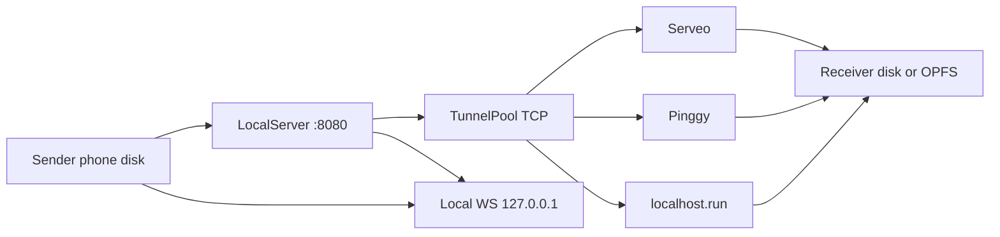
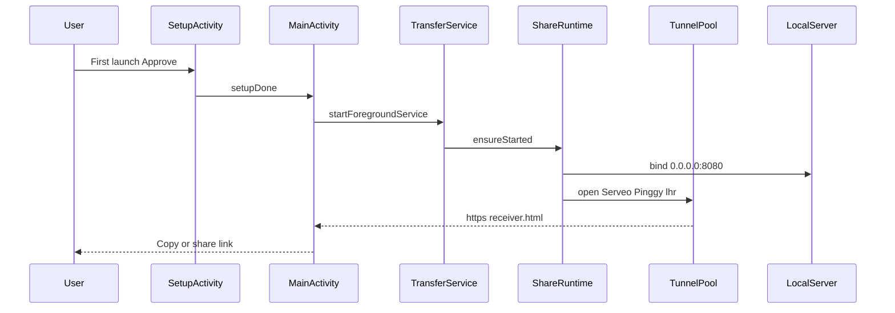
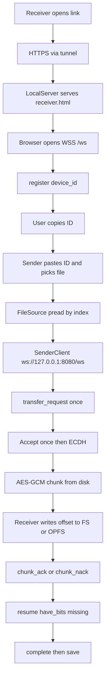
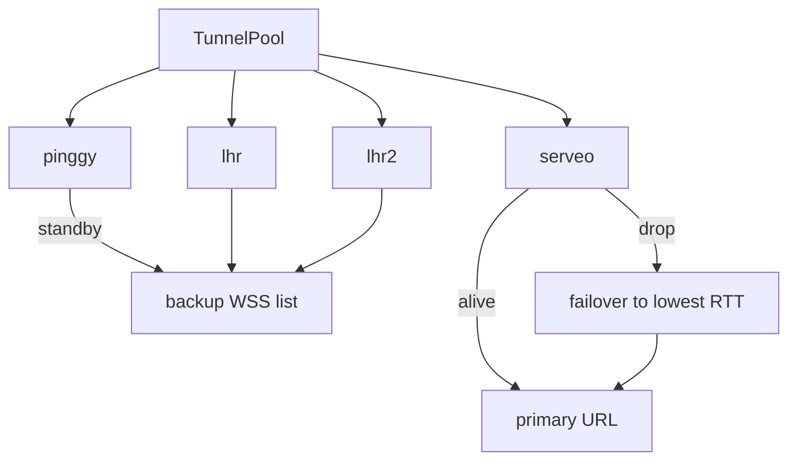
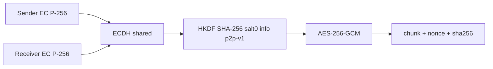
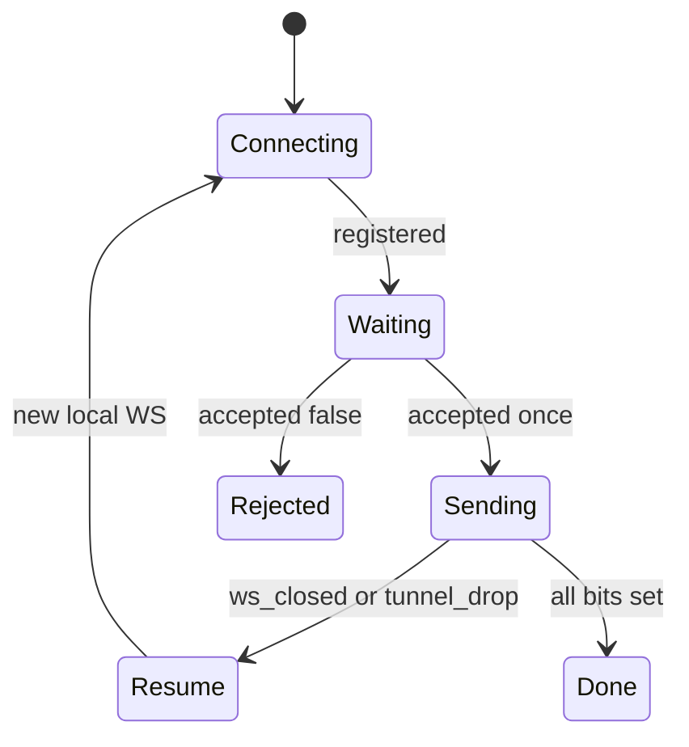

# خريطة هيكل عمل التطبيق — نقل آمن

هذا الملف يشرح كيف يشتغل التطبيق من لحظة الفتح حتى اكتمال الملف عند المستلم. لا يعتمد على شبكة مشتركة بين المرسل والمستلم. مسار البيانات بث من القرص إلى القرص حتى تعمل ملفات بحجم الجيجا.

---

# 1. الفكرة العامة

المرسل هاتف أندرويد خلف واي فاي أو CGNAT. المستلم أي متصفح في أي بلد.

لا يوجد خادم ملفات خاص بالمطور. الهاتف نفسه يشغّل خادما محليا على المنفذ 8080. أنفاق SSH TCP متعددة تنشر هذا المنفذ على الإنترنت. المستلم يفتح صفحة HTML. الملف يُشفَّر على الهاتف قبل الخروج. القراءة عند المرسل والكتابة عند المستلم متدفقة: لا يُحمَّل الملف كاملا في الذاكرة.



---

# 2. خريطة الملفات

```text
p2p-android/
  build-android.sh
  app/src/main/AndroidManifest.xml
  app/src/main/java/com/p2psecure/share/
    ShareApp.kt
    SetupActivity.kt
    MainActivity.kt
    SettingsActivity.kt
    TransferService.kt
    ShareRuntime.kt
    TunnelPool.kt
    JavaTunnel.kt
    LocalServer.kt
    FileSource.kt
    SenderClient.kt
    CryptoEngine.kt
    AppLog.kt
    Prefs.kt
    ThemeHelper.kt
    LocaleHelper.kt
    NetworkHelper.kt
    NgrokHelper.kt
  app/src/main/assets/receiver.html
  app/src/main/assets/privacy_policy.html
```

| ملف | دوره |
|-----|------|
| ShareApp | نقطة التطبيق وتطبيق اللغة |
| SetupActivity | أول تشغيل وموافقة المستخدم |
| MainActivity | واجهة المرسل والمراقبة. يفتح الملف عبر SAF كـ ParcelFileDescriptor |
| TransferService | خدمة أمامية تبقي النفق حيا |
| ShareRuntime | تشغيل الخادم ومجموعة الأنفاق |
| TunnelPool | عدة أنفاق TCP مع تحويل عند السقوط |
| JavaTunnel | جلسة SSH reverse-forward لمزوّد واحد |
| LocalServer | HTTP + WebSocket على 8080 |
| FileSource | قراءة قطعة من القرص بـ pread دون تحميل الملف |
| SenderClient | إرسال مشفر مع استئناف وإعادة القطع |
| CryptoEngine | ECDH + HKDF + AES-GCM |
| receiver.html | صفحة المستلم: كتابة متدفقة واستئناف محفوظ |
| AppLog / ConnStats | السجل الحي والسرعة وRTT |

---

# 3. دورة حياة التشغيل



خطوات مختصرة:

1. أول فتح: SetupActivity. موافقة ثم حفظ setupDone
2. MainActivity تبدأ TransferService
3. الخدمة تأخذ WakeLock وتشغّل حلقة ensureStarted
4. LocalServer يسمع على 8080
5. TunnelPool يفتح مزودين بالتوازي
6. أول نفق ناجح يصبح الرابط الأساسي
7. الواجهة تعرض الرابط وتمنع الإرسال حتى يصبح HTTPS حقيقيا

---

# 4. مسار الإرسال الحقيقي

المشكلة القديمة: المرسل كان يتصل بنفسه عبر الإنترنت فيفشل بسبب CGNAT. التصحيح: المرسل يتصل محليا.

مسار البايتات الحالي: القرص عند المرسل ثم قطعة مشفرة ثم النفق ثم القرص أو OPFS عند المستلم. لا `readBytes()` لكل الملف ولا مصفوفة chunks في المتصفح.



نقاط مهمة:

- صفحة المستلم تأتي من أصول التطبيق `assets/receiver.html`
- WebSocket للمستلم: `wss://tunnel-host/ws`
- WebSocket للمرسل: `ws://127.0.0.1:8080/ws`
- LocalServer يمرر الرسائل بين device_id ولا يكدّس رسائل chunk في الطابور
- المعرف يُطبَّع إلى 16 خانة hex حتى لا يفشل اللصق
- حجم القطعة 49152 بايت ويُرسل في `chunk_size`
- القبول مرة واحدة للملف كله وليس لكل قطعة

---

# 5. الأنفاق المتعددة

المزوّدون في `JavaTunnel.PROVIDERS`:

- serveo.net:22
- a.pinggy.io:443
- localhost.run:22
- ssh.localhost.run:22

كل مزود جلسة JSch منفصلة وreverse port forward إلى 127.0.0.1:8080.



قواعد الاستقرار:

- لا يُعرض dashboard.pinggy.io ولا console.serveo.net
- يُقبل `*.serveousercontent.com` و `*.free.pinggy.net` و `*.lhr.life`
- Watchdog يقرأ خرج SSH ويكشف closed/expired
- الصفحة تحقن BACKUP_WS وتتحول لمسار آخر عند انقطاع WSS
- الرابط الظاهر يتحدث إذا تغيّر النفق الأساسي. يجب مشاركة الرابط الجديد إن تغيّر قبل بدء النقل

---

# 6. التشفير



- كل طرف يولّد مفتاح ECDH منحنى P-256
- الاشتقاق HKDF-SHA256 بطول 32 بايت
- كل قطعة لها nonce عشوائي 12 بايت
- المستلم يتحقق من hash القطعة قبل ACK
- القطعة التالفة ترسل chunk_nack فيُعاد إرسالها
- SHA-256 الكامل يُحسب عند المرسل بتمريرة على القرص قبل الإرسال

الخادم المحلي والأنفاق لا يملكون مفتاح AES.

---

# 7. الاستئناف بعد سقوط النفق



عند السقوط:

1. TunnelPool يحذف النفق الميت ويفتح بديلا
2. المستلم يعيد الاتصال عبر BACKUP_WS أو نفس المضيف
3. يرسل resume فيه have_bits (خريطة بتات) وعينة missing[]
4. المرسل لا يعيد القطع السليمة. يقرأ الناقص من القرص فقط
5. القبول لا يُطلب مرة أخرى لنفس الملف ونفس الصفحة
6. حالة النقل تُحفظ في IndexedDB ويمكن استعادة ملف OPFS بعد إعادة فتح الصفحة
7. لا يوجد سقف 20 دقيقة. الإرسال يستمر حتى اكتمال القطع أو توقف المستخدم

---

# 8. الواجهة

المرسل:

- رابط المستلم نسخ/مشاركة
- لصق المعرف
- اختيار ملف واحد SAF
- شريط تقدم وحالة تجهيز الملف ثم الإرسال
- زر المراقبة: الحالة، السرعة، RTT، جودة، قائمة الأنفاق، السجل الحي

المستلم:

- رقم تعريفي ثابت لنفس المتصفح ما دام لم يُفرَّغ
- تنبيه عربي وإنجليزي: ارجع للصفحة بعد إرسال الرقم وابق حتى النهاية
- قبول مرة واحدة ثم حفظ مباشر (File System Access) أو OPFS
- تقدم حتى اكتمال الكتابة على القرص

---

# 9. الصلاحيات ولماذا كل واحدة

| صلاحية | السبب |
|--------|--------|
| INTERNET | أنفاق SSH وصفحة المستلم |
| ACCESS_NETWORK_STATE | معرفة وجود شبكة |
| POST_NOTIFICATIONS | إشعار الخدمة الأمامية |
| FOREGROUND_SERVICE / DATA_SYNC | إبقاء النقل أثناء الخلفية المحدودة |
| WAKE_LOCK | منع نوم CPU أثناء النفق |
| READ_MEDIA_* | اختيارية عبر المنتقي وليست إلزامية |

لا توجد صلاحية إدارة كل الملفات.

---

# 10. حدود يجب معرفتها

- التطبيق يجب أن يبقى مفتوحا والإشعار ظاهر
- الأنفاق العامة قد تسقط أو تتغير أسماء المضيف. الجودة تأتي من الاستئناف
- السرعة تمر عبر وسيط مجاني فهي أقل من إرسال محلي
- المرسل يقرأ بالقطعة من القرص. المستلم يكتب على القرص أو OPFS
- ملف 2 جيجا ممكن تقنيا. الزمن يعتمد على النفق. أبق الصفحة مفتوحة
- كروم/إيدج سطح المكتب أفضل مسار لاستلام الجيجات عبر showSaveFilePicker
- كروم أندرويد يستخدم OPFS ثم تنزيل عند الاكتمال
- سفاري آيفون ضعيف للملفات الضخمة
- تجزئة SHA-256 قبل الإرسال تمر على الملف كاملا من القرص (وقت تجهيز وليس ذاكرة)

---

# 11. مسار بيانات ملف كبير من الدلتا إلى أستراليا

1. أنت تفتح التطبيق في الدلتا على واي فاي
2. الهاتف يفتح :8080 وSSH إلى Serveo أو Pinggy
3. يظهر `https://xxxx.serveousercontent.com/receiver.html`
4. صديقك في أستراليا يفتح الرابط. الطلب يصل للنفق ثم لهاتفك
5. يظهر له معرف. يرسله لك
6. تلصق المعرف وتختار ملفا حتى 2 جيجا. التطبيق يحسب الهاش من القرص ثم يبدأ
7. الطلب يظهر عنده. يضغط قبول مرة واحدة ويختار مكان الحفظ إن تاح
8. القطع المشفرة تخرج من الهاتف بالفهرس عبر النفق وتُكتب عنده فورا
9. إن قطع النفق يكمل من آخر قطعة سليمة دون قبول جديد
10. عند اكتمال كل البتات يُغلق ملف الحفظ

---

# 12. توافق سطح المكتب

`p2p-desktop` يتحدث بنفس البروتوكول:

- مرسل محلي `ws://127.0.0.1:8080/ws`
- قطعة 49152 وقراءة seek من الملف
- مجمع أنفاق SSH وBACKUP_WS
- نفس `receiver.html`
- نافذة إرسال 32 و`have_bits` في resume
